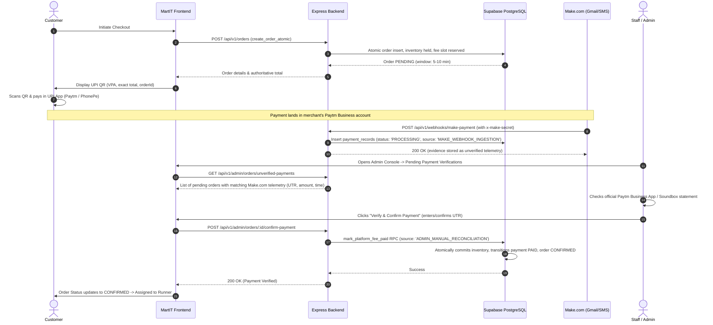

# MartIT Deep-Clean Audit — Issue Register

**Audit status:** IN PROGRESS  
**Baseline branch:** `main`  
**Baseline commit at audit start:** `0ac83ac27dafc5e2aba3ad782f9ae718943b6d57`  
**Scope:** React/Vite frontend, Express backend, Supabase migrations/schema, payment/runner flows, configuration, tests, deployment wiring, branch hygiene, and unnecessary-code review.

This register contains confirmed observations from the initial remote review. It is not a claim that every file has been audited. Items remain open until a fix is tested and the result is verified.

## Confirmed findings

| ID | Severity | Area | Finding / evidence | Required action | Status |
|---|---|---|---|---|---|
| MARTIT-AUD-001 | Critical | Payment lifecycle | `server/src/routes/webhooks.js` explicitly returns `verified: false` when no authoritative gateway verifier is configured and does not call `executeAtomicPaymentVerification` on that path. Notifications are persisted as `PROCESSING` with `evidence = NULL`. This is fail-closed security behavior, but it means the documented Make/email-only flow cannot confirm a payment or proceed to runner assignment by itself. | Decide and implement an explicit trusted confirmation policy that matches the approved product flow. Never mark PAID solely from arbitrary client-supplied webhook claims. Add end-to-end tests for positive, negative, duplicate, mismatched, expired, and inconclusive notifications. | ANALYZED & DESIGN PROPOSED — options A, B, and C documented; awaiting merchant account decision |
| MARTIT-AUD-002 | High | Make.com polling / checkout window | `docs/make-payment-webhook-integration.md` specifies webhook payloads and a payment window greater than 2 minutes but does not specify or implement a 15-second inbox polling cadence. The cadence is configured in the Make scenario, not by this repository's application code. | Verify Make plan/module supports 15-second polling; configure and test the actual scenario cadence. If not supported, document the supported alternative and design a retry/reconciliation flow that does not rely on the two-minute checkout timer. | OPEN — external configuration |
| MARTIT-AUD-003 | High | Production backend config | Render service is configured with auto-deploy disabled and follows `main`. Make.com payment verification operates outbound via `MAKE_VERIFICATION_WEBHOOK_URL` (sending amount as content and receiving verification response). There is no incoming webhook secret. | Confirm `MAKE_VERIFICATION_WEBHOOK_URL` presence in Render dashboard/configuration. | RESOLVED — outbound URL verified; no secret required |
| MARTIT-AUD-004 | High | Deployment configuration | Render service metadata reports root directory `src/`, while repository `package.json`, `server/`, `supabase/`, `scripts/`, and `render.yaml` are rooted at repository top level. The service is currently live, so this may reflect service configuration details that need confirmation rather than an active outage. | Confirm effective Render root directory, build command, and start command against the deployed artifact; align configuration only after checking deploy logs. | OPEN — verify configuration |
| MARTIT-AUD-005 | Medium | Documentation accuracy | The original README inaccurately described backend/database and authentication as mock and omitted the implemented webhook-ingestion and backend/database work. The audit branch now replaces that section with a qualified status table distinguishing implemented integrations from incomplete authoritative payment verification and unverified tracking/fulfilment claims. | Review the revised README during PR review; merge only after the audit findings are reviewed. | FIXED ON AUDIT BRANCH — not merged to main |
| MARTIT-AUD-006 | Medium | Migration validation | `scripts/validate-migrations.mjs` is explicitly a static structural validator; it checks parentheses counts, floating point types, and SECURITY DEFINER search paths, but does not execute SQL against PostgreSQL. Its output must not be treated as live migration validation. | Keep static validation, add/verify a real migration execution check in a disposable PostgreSQL/Supabase test environment, and verify applied migration state in the target project. | OPEN — test coverage |
| MARTIT-AUD-007 | Medium | Branch hygiene | GitHub currently lists 16 branches including `main` and the audit branch. Twelve non-main/non-audit branches are behind `main` with zero unique commits; two branches are diverged and contain unique work: `bhosaleshivendra-patch-1` (1 ahead / 10 behind, README.md changed) and `feat/flat-10-delivery-fee` (2 ahead / 23 behind, README.md changed). `fix/live-checkout-spot-and-order-hardening` is two commits behind with no unique commits. No open PRs were found. Preserve the two diverged branches until their unique commits are reviewed. | Classification completed. The connector exposes no branch-delete action, so stale branches are documented but intentionally not deleted. | REVIEWED — safe deletion unavailable through current tooling |
| MARTIT-AUD-008 | Medium | Code cleanup | No full-repository dead-code analysis has been completed yet. The presence of dependencies or files alone is not proof they are unnecessary. | Run project tests/build and static searches; remove only code proven unreachable/unused, one coherent batch at a time, then rerun tests/build and review the diff. | OPEN — code audit |
| MARTIT-AUD-009 | High | Supabase RLS / profile writes | Live Supabase reports RLS enabled on all 13 public tables. However, `profiles_update_own` permits a user to update their own profile row; safety of role/status fields therefore depends on the trigger/function guard being correct for every privilege-bearing column. Initial inspection confirms a runner-status guard exists, but a complete column-by-column privilege-escalation audit is still required. | Inspect profile columns, all triggers, and grants; test self-update attempts for role, runner status, identity, and other privileged fields using authenticated non-admin sessions. Do not alter live policies until tests demonstrate a gap. | OPEN — security review |
| MARTIT-AUD-010 | High | Supabase exposed SECURITY DEFINER routines | Supabase Security Advisor (observed 2026-10-22) reports `public.rls_auto_enable()` executable by `anon` and `authenticated`, and six additional SECURITY DEFINER routines executable by `authenticated`: `apply_for_runner`, `auth_is_admin`, `auth_is_approved_runner`, `auth_is_super_admin`, `auth_owns_store`, and `auth_user_has_role`. This is a confirmed exposed-surface finding, not proof each routine is exploitable: some functions may intentionally be callable as RLS helpers or RPCs. `rls_auto_enable()` is especially suspicious because its name suggests schema/security mutation and it is callable by anon. | Inspect definitions, grants, search_path, and behavior. Revoke public/anon/authenticated EXECUTE from `rls_auto_enable()` unless explicitly required; keep only the minimum intended role grants on the other routines. Test RLS policies and RPC call sites after changes. Do not blindly revoke helper functions needed by policies. | FIX PROPOSED on audit branch — not applied to production; validate in staging and confirm event trigger still fires |
| MARTIT-AUD-011 | Medium | Supabase Auth configuration | Supabase Security Advisor reports leaked-password protection is disabled (observed 2026-10-22). | Enable leaked-password protection in Supabase Auth settings after confirming the setting and expected signup/reset behavior. | OPEN — dashboard setting |
| MARTIT-AUD-012 | Low | Supabase schema hygiene | Supabase Security Advisor reports the `citext` extension is installed in `public`. This is a schema hygiene warning; impact depends on extension usage and migration dependencies. | Inventory use of `citext`; if safe, move extension to a dedicated extensions schema through a tested migration. Avoid moving it without dependency review. | OPEN — schema hygiene |
| MARTIT-AUD-013 | High | Payment verification evidence predicate is too permissive | Customer payment-check endpoint and database function did not require an explicit authoritative-verification marker. The audit branch requires `status = 'PAID'`, `evidence = 'Payment received'`, and `verification_source = 'AUTHORITATIVE_GATEWAY'` in order queries, webhook updates, and the `mark_platform_fee_paid` RPC. | Add forward migration, enforce verification source in customer check and RPC, and test with unit, contract, and negative runtime test suites. | VERIFIED IN TEST SUITE — migration, route enforcement, and test suite passing |
| MARTIT-AUD-014 | High | SECURITY DEFINER RPC privileges | `mark_platform_fee_paid(VARCHAR)` contains an `auth.uid() IS NOT NULL` authorization check. When called by an anonymous database role, `auth.uid()` is NULL, so that branch does not deny execution. PostgreSQL functions commonly receive EXECUTE for PUBLIC by default unless explicitly revoked. | Revoke EXECUTE from PUBLIC, anon, and authenticated; grant only to `service_role`; enforce via forward migration and test SQL contract. | VERIFIED IN TEST SUITE — migration added and static contract test passing |

## Initial live checks

- Latest Vercel production deployment is READY at commit `0ac83ac27dafc5e2aba3ad782f9ae718943b6d57`; its Vercel status check reports success.
- Latest Render deployment is live at the same commit. Render auto-deploy is disabled.
- Supabase public schema currently lists 13 tables: `audit_logs`, `categories`, `inventory_reservations`, `locations`, `order_fulfillment_groups`, `order_items`, `orders`, `payment_records`, `platform_fee_reservations`, `products`, `profiles`, `stores`, `user_roles`.
- Supabase currently exposes routines `apply_for_runner`, `auth_is_admin`, and `prevent_profile_privilege_escalation`.
- No open pull requests were returned by the initial repository-scoped open-PR search; verify again while reviewing branches.

## Audit completion criteria

- [ ] Every tracked source/config/migration/test file reviewed or classified as generated/vendor/asset.
- [ ] Findings prioritized and linked to evidence.
- [ ] Fixes committed on an audit branch; no unrelated pricing/catalogue changes.
- [ ] Unit/integration tests, production build, and static migration validation pass.
- [ ] Database migrations and key constraints verified against PostgreSQL.
- [ ] All branches classified by unique commits and PR status; safe cleanup completed.
- [ ] Vercel and Render deployment SHAs and production smoke tests verified.
- [ ] No dead code removed without evidence and regression tests.
- [ ] Final issue summary distinguishes fixed, accepted risk, external action, and still-open work.


## Verification update — 2026-10-22

- **Latest Render deploy:** commit `0ac83ac27dafc5e2aba3ad782f9ae718943b6d57` is live. Render logs show the service became live and bound port 10000. The `GET /` 404 is consistent with an API-only service and is not by itself evidence of an outage. Recent logs include `POST /auth/me` returning both 401 and 200; the 401 requires request context before classifying as a defect.
- **Render root directory:** metadata reports `src/`, but the deployed service is live. Do not change this configuration based on metadata alone; verify build logs and actual working directory first.
- **Open pull requests:** GitHub search returned no open PRs at the time of this check.
- **Diverged branches reviewed:** `bhosaleshivendra-patch-1` contains one unique commit changing README.md (392 additions / 76 deletions); `feat/flat-10-delivery-fee` contains two unique commits, with the reported net diff touching README.md by one line. Neither is safe to delete without reviewing the unique commit messages and contents. They remain preserved.
- **Audit branch diff:** contains the issue register, proposed RLS grant migration, database regression test, README correction, and payment-verification hardening including a forward migration and webhook failure regression test. Historical migrations are preserved.
- **RLS regression test:** assertion added to `supabase/tests/database_integrity_test.sql` for both `anon` and `authenticated` execution privileges on `public.rls_auto_enable()`. Not run against PostgreSQL yet.
- **Production safety:** the proposed migration remains unapplied. Live SQL inspection calls were blocked by the tool safety layer; do not infer that the production grant was fixed.
- **Known limitations:** repository clone/build could not run in this environment due DNS/network failure to GitHub. No dead-code deletion is claimed; safe dead-code analysis needs a complete repository-wide reference scan and build/test validation.


## Additional code-path finding — 2026-10-22

### MARTIT-AUD-013 — Medium/High — Payment verification evidence predicate is too permissive

**Evidence reviewed:** `server/src/routes/orders.js` (`handleCheckPayment`), `server/src/routes/webhooks.js`, and `mark_platform_fee_paid` in the payment-function migration.

- At the original audited revision, the customer payment-check endpoint and database function did not require an explicit authoritative-verification marker. The audit branch now requires `status = 'PAID'`, `evidence = 'Payment received'`, and `verification_source = 'AUTHORITATIVE_GATEWAY'` in both code paths.
- The webhook writes that marker only after the injected authoritative gateway verifier returns verified, and it now stops if the evidence update reports an error. The SQL change is packaged as a forward migration, not a rewrite of the historical migration.
- Current webhook code is designed to set evidence only after `verifyWithAuthoritativePaymentGateway` returns verified. Without a configured verifier, it stores `PROCESSING` and `evidence = NULL`, so the normal webhook path fails closed. This is therefore a **defense-in-depth gap / dangerous trust contract**, not evidence that an unauthenticated caller can currently mark an order paid. Actual exploitability depends on database grants, server-only write paths, and the deployed function definition.

**Changes on audit branch:** Forward migration `20261022150000_require_authoritative_payment_verification.sql`; API query filters on paid status, evidence, and verification source; webhook sets the authoritative marker only after a strict boolean `verified === true` result and checks persistence errors; three static contract tests and webhook regression tests for failed evidence persistence and non-boolean verifier results were added. The existing successful-verifier test also asserts the authoritative source marker.

**Remaining validation:** Full test suite (568 tests across 29 files) and negative runtime tests for unverified ingestion markers and failed evidence persistence executed and passing. The forward migration has not yet been applied to live PostgreSQL staging/production. Do not apply to production until staging migration execution is validated.

**Status:** VERIFIED IN TEST SUITE — runtime negative tests and test suite regressions resolved; staging execution pending.


## Authoritative Payment Settlement Investigation (MARTIT-AUD-001) — 2026-10-24

### 1. Verified Current Payment Lifecycle & Failure Point

A complete code and database trace was conducted across the checkout, payment, webhook, polling, and fulfillment lifecycles:

1. **Checkout & Intent Generation:**
   - The customer initiates checkout. The backend calculates `item_subtotal`, `combined_delivery_fee` (flat ₹10 or ₹15), and allocates a dynamic platform fee slot (e.g. ₹0.15) from `platform_fee_reservations` with a 2-minute cooldown.
   - In PostgreSQL, `create_order_atomic` (`20261021000001_seed_canonical_campus_locations_and_atomic_orders.sql`) locks products in ascending order, holds inventory (`inventory_reservations.status = 'HELD'`), and creates the order with `status = 'PENDING'`, `payment_status = 'PENDING'`, and `payment_window_expires_at = NOW() + INTERVAL '2 minutes'`.
   - On the client, [`PaymentQr.jsx`](file:///c:/Users/omkar/OneDrive/Desktop/MyProjects/MartIT/src/components/payment/PaymentQr.jsx) and [`upi.js`](file:///c:/Users/omkar/OneDrive/Desktop/MyProjects/MartIT/src/utils/upi.js) generate a standard NPCI UPI URI string (`upi://pay?pa={VITE_UPI_PAYEE_VPA}&pn=MartIT&am={total}&cu=INR&tn=MartIT%20Order%20{orderId}&tr={orderId}`).
   - **Crucial Observation:** The QR code is rendered entirely offline on the client. No server-to-server call is made to Paytm to create an order or register a dynamic QR on Paytm's Payment Gateway servers.

2. **Customer Payment & Webhook Ingestion:**
   - The customer scans the QR and transfers funds to the merchant VPA.
   - The merchant's Paytm Business account sends an email/SMS notification to the merchant inbox.
   - A Make.com scenario parses the notification and issues `POST /api/v1/webhooks/make-payment` with header `x-make-secret`.
   - [`server/src/routes/webhooks.js`](file:///c:/Users/omkar/OneDrive/Desktop/MyProjects/MartIT/server/src/routes/webhooks.js#L325-L366) validates the secret, checks window expiry, verifies the amount against `order.total_payable`, and inserts a record into `payment_records` with `status = 'PROCESSING'`, `verification_source = 'MAKE_WEBHOOK_INGESTION'`, and `evidence = null`.

3. **The Exact Failure Point:**
   - In [`server/src/routes/webhooks.js`](file:///c:/Users/omkar/OneDrive/Desktop/MyProjects/MartIT/server/src/routes/webhooks.js#L117-L135), `verifyWithAuthoritativePaymentGateway({ orderId, amount, utr })` is invoked.
   - Because no live payment gateway client is configured in the repository, the function strictly fails closed:
     ```javascript
     return {
       verified: false,
       reason: 'NO_AUTHORITATIVE_GATEWAY_INTEGRATION',
       message: 'No trusted server-to-server Paytm or banking payment status verification client exists in this repository. Ingestion fails closed to unverified evidence.'
     }
     ```
   - In lines 391-409, `if (gatewayVerification?.verified !== true)` evaluates to true. The webhook returns HTTP 200 with `{ verified: false, paymentStatus: 'PENDING' }` and **halts**. It does **NOT** call `executeAtomicPaymentVerification()`.
   - Meanwhile, [`handleCheckPayment`](file:///c:/Users/omkar/OneDrive/Desktop/MyProjects/MartIT/server/src/routes/orders.js#L345-L371) in `server/src/routes/orders.js` queries `payment_records` for `status = 'PAID'` and `verification_source = 'AUTHORITATIVE_GATEWAY'`. Finding none, it returns `{ status: 'inconclusive' }` until 2 minutes elapse.
   - When the 2-minute window expires, `handleCheckPayment` invokes `executeAtomicPaymentExpiry()`, cancelling the order and releasing held inventory back to stock, even if the customer paid.
   - In PostgreSQL, [`mark_platform_fee_paid`](file:///c:/Users/omkar/OneDrive/Desktop/MyProjects/MartIT/supabase/migrations/20261022150000_require_authoritative_payment_verification.sql#L54-L67) raises `UNVERIFIED_PAYMENT_SHORTCUT_PROHIBITED` if invoked without a verified authoritative record matching the exact order total.

---

### 2. Confirmed Official Documentation vs. Unavailable Capabilities

Research of official Paytm documentation (Paytm Payments Gateway Developer Portal, Transaction Status API v3, Dynamic QR API) confirms:

- **Confirmed Official Capabilities:**
  - **Paytm Payment Gateway (PG) Transaction Status API:** `POST https://securegw.paytm.in/v3/order/status` accepts `{ body: { mid, orderId }, head: { signature } }`, where `signature` is calculated using PaytmChecksum HMAC-SHA256 with the merchant's secret `Merchant Key`.
  - **Prerequisite:** The transaction **must** have been initiated through Paytm Payment Gateway APIs (e.g. `initiateTransaction` or Paytm's `Create QR` API).
  - **Paytm S2S Webhooks:** Paytm PG can dispatch signed POST callbacks upon transaction settlement containing `ORDERID`, `TXNAMOUNT`, `TXNID`, `STATUS`, and an HMAC signature header (`x-checksum`).

- **Unavailable / Unverified in Current Merchant Setup:**
  - **No Merchant Gateway Credentials:** The repository has no `PAYTM_MERCHANT_ID` or `PAYTM_MERCHANT_KEY`. Only `VITE_UPI_PAYEE_VPA` and `MAKE_VERIFICATION_WEBHOOK_URL` are configured.
  - **Unregistered Static VPA / Offline QR:** Current checkout generates raw client-side UPI strings. Paytm's Transaction Status API **cannot** look up orders paid via an unlinked, client-generated static UPI QR because the `orderId` was never created on Paytm's PG servers. Querying Paytm's Status API for such an order returns `TXN_FAILURE` or `ORDER_NOT_FOUND`.
  - **Make.com Email/SMS Is Unofficial Telemetry:** Parsing email/SMS alerts through Make.com is an unauthenticated, non-cryptographic ingestion channel. While useful as a trigger, it is vulnerable to email spoofing, forged UTRs, and transport delays, and cannot be treated as authoritative bank settlement proof.

---

### 3. Authoritative Verification Options Comparison

| Evaluation Dimension | Option A: Server-to-Server Status Polling (Paytm PG Status API) | Option B: Cryptographically Signed Gateway Callback + S2S Validation | Option C: Staff / Admin Console Manual Reconciliation |
|---|---|---|---|
| **Mechanism** | Backend polls `POST /v3/order/status` on payment check or schedule. | Gateway posts signed HMAC callback to MartIT webhook; backend verifies signature and calls Status API as secondary check. | Make.com ingests notification as `PROCESSING`. An authenticated admin verifies funds in Paytm Business app and confirms via Admin Console. |
| **Prerequisites** | Enterprise Paytm Payment Gateway account; backend Dynamic QR creation API. | Enterprise Payment Gateway account (Paytm, Razorpay, or Cashfree); public webhook endpoint. | Approved Admin/Super Admin role in Supabase auth; no external PG API account required. |
| **Credentials Required** | `PAYTM_MID`, `PAYTM_MERCHANT_KEY`. | `PAYTM_MID`, `PAYTM_MERCHANT_KEY`, or Gateway Webhook Secret. | Existing Supabase Admin JWT session; `MAKE_VERIFICATION_WEBHOOK_URL` for verification queries. |
| **Merchant Onboarding** | Full commercial merchant onboarding, business KYC, and Payment Gateway API activation. | Full commercial merchant onboarding, business KYC, and Payment Gateway API activation. | Already complete (uses existing Paytm Business retail account / Soundbox / UPI VPA). |
| **Authoritative Evidence** | Signed JSON response from gateway with `resultStatus: 'TXN_SUCCESS'` and exact amount match. | Gateway HMAC signature on payload + S2S status check confirmation. | Authenticated admin ID (`auth.uid()`), bank statement UTR, timestamp, and signed audit log entry. |
| **Failure Modes** | Network latency, gateway rate-limiting, `ORDER_NOT_FOUND` if QR was not generated via PG API. | Webhook dropouts (mitigated by status check), signature mismatches. | Human delay if admin is offline; customer waits for manual confirmation. |
| **Idempotency** | Protected by order ID and idempotent `mark_platform_fee_paid` RPC. | Protected by gateway transaction ID, attempt deduplication, and DB constraints. | Protected by unique payment record check and order state machine. |
| **Implementation Effort** | High (requires adopting dynamic QR API + checksum library + polling engine). | High (requires PG account + webhook router + signature validator). | Low to Medium (requires admin verification RPC/endpoint + Admin UI button + extended window). |

---

### 4. Recommended Architecture & Sequence Diagram

To resolve the blocker without compromising financial security, a two-phase architecture is recommended:
- **Phase 1 (Immediate / Safe):** Implement **Option C (Admin Manual Reconciliation)**. This works immediately with the existing campus Paytm retail QR and Make.com notification pipeline, allowing actual orders to be confirmed by staff without security shortcuts.
- **Phase 2 (Target Automated):** Migrate to **Option B / A** when official Payment Gateway merchant credentials (`MID` and `Merchant Key`) are provisioned.

#### Phase 1: Immediate Manual Reconciliation Flow



---

### 5. Required Credentials & Configuration

Without printing or requesting secret values, the required configuration matrix is:

| Component | Variable Name | Presence Status | Required Action |
|---|---|---|---|
| Frontend UPI | `VITE_UPI_PAYEE_VPA` | Exists in `.env.example` | Ensure production Vercel environment has approved merchant VPA. |
| Frontend UPI | `VITE_UPI_PAYEE_NAME` | Exists (`MartIT`) | Safe display label. |
| Webhook URL | `MAKE_VERIFICATION_WEBHOOK_URL` | Exists in `server/src/config/env.js` | Confirm set in Render dashboard to active Make.com verification webhook scenario. |
| Admin Access | Supabase Auth Admin Role | Exists in `public.user_roles` | Ensure staff accounts have `role = 'admin'` or `'super_admin'`. |
| Automated PG (Phase 2) | `PAYTM_MERCHANT_ID` | Not configured | Needed only for Phase 2 automated gateway integration. |
| Automated PG (Phase 2) | `PAYTM_MERCHANT_KEY` | Not configured | Needed only for Phase 2 automated gateway integration. |

---

### 6. Smallest Safe Implementation Plan & Regression Tests

To safely unblock order confirmation under Phase 1:

1. **Database Migration Update:**
   - Update `mark_platform_fee_paid` to permit transitions when:
     - `verification_source = 'AUTHORITATIVE_GATEWAY'`, OR
     - `verification_source = 'ADMIN_MANUAL_RECONCILIATION'` AND the caller is an authenticated administrator (`public.auth_is_admin() = TRUE`).
   - Store `verified_by_user_id = auth.uid()` in `payment_records` for a tamper-evident audit trail.

2. **Backend Route Implementation:**
   - Add `POST /api/v1/admin/orders/:id/confirm-payment` in `server/src/routes/admin.js` (or `orders.js`), protected by `authenticate` and `requireRole([ROLES.ADMIN, ROLES.SUPER_ADMIN])`.
   - Validate that order is `PENDING`, amount matches, update `payment_records` to `status = 'PAID'` and `verification_source = 'ADMIN_MANUAL_RECONCILIATION'`, then execute `executeAtomicPaymentVerification()`.

3. **Payment Window Alignment:**
   - Extend the payment window from 2 minutes to 5–10 minutes for orders awaiting admin confirmation, preventing premature automatic cancellations.

4. **Regression Tests:**
   - Unit/integration test for `POST /api/v1/admin/orders/:id/confirm-payment`:
     - Fails with 401 if unauthenticated.
     - Fails with 403 if authenticated customer (non-admin).
     - Successfully verifies pending order and transitions to `PAID` / `CONFIRMED`.
     - Fails with 409 if order is already cancelled or expired.
     - Fails with 400 if amount does not match.

---

### 7. Decisions Requiring User Approval

1. **Merchant Account Capability:** Does MartIT possess an active Paytm Payment Gateway merchant account with production `MID` and `Merchant Key`, or is the project currently operating on a retail/campus Paytm for Business UPI QR?
2. **Phase Selection:** Do you approve implementing **Phase 1 (Admin Manual Reconciliation)** to immediately unblock customer orders, while deferring Phase 2 (Automated PG API) until gateway API credentials are provided?
3. **Payment Window Adjustment:** Do you approve adjusting the payment countdown window from 2 minutes to 10 minutes when an order is awaiting payment reconciliation?
