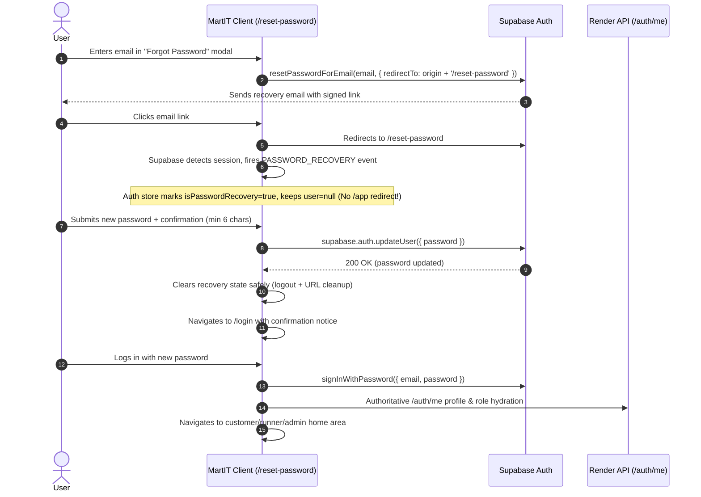

# Supabase Auth URL Configuration & Password Recovery Guide

This document describes the exact configuration required in Supabase, Vercel, and Render for MartIT's password recovery (`/reset-password`) and remote authentication flows.

---

## 1. Supabase Dashboard: URL Configuration

In the [Supabase Dashboard](https://supabase.com/dashboard):
1. Navigate to your project.
2. Go to **Authentication** (left sidebar) → **URL Configuration**.

### A. Site URL
- **Local Development**: `http://localhost:5173`
- **Production (Vercel)**: `https://martit.vercel.app` (or your primary custom domain)

> [!NOTE]
> When `authService.forgotPassword()` runs, it supplies an explicit `redirectTo` parameter: `${window.location.origin}/reset-password`. Supabase requires that this URL matches an allowed redirect entry.

### B. Redirect URLs (Allowlist)
Add the following entries to the **Redirect URLs** list:

#### Local Development
```text
http://localhost:5173/reset-password
http://localhost:5173/**
http://localhost:3000/reset-password
http://localhost:3000/**
```

#### Production (Vercel)
```text
https://martit.vercel.app/reset-password
https://martit.vercel.app/**
https://*.vercel.app/reset-password
https://*.vercel.app/**
```

*(If you have a custom production domain, e.g. `https://martit.com`, add `https://martit.com/reset-password` and `https://martit.com/**` as well).*

---

## 2. Environment Variables Matrix

### A. Vercel Dashboard (Frontend)
Settings → Environment Variables:

| Variable | Value | Description |
| :--- | :--- | :--- |
| `VITE_API_BASE_URL` | `https://martit-server.onrender.com` | Render Express API base URL (leave empty for demo mock mode) |
| `VITE_SUPABASE_URL` | `https://<project-ref>.supabase.co` | Public Supabase API URL |
| `VITE_SUPABASE_ANON_KEY` | `<supabase-anon-key>` | Public Anon Key (**NEVER service role key**) |
| `VITE_UPI_PAYEE_NAME` | `MartIT` | Display name for UPI payment QR |
| `VITE_UPI_PAYEE_VPA` | `merchant@oksbi` | Merchant UPI VPA |

### B. Render Dashboard (Backend Web Service)
Environment Settings:

| Variable | Value | Description |
| :--- | :--- | :--- |
| `PORT` | `10000` | Port for Express server |
| `NODE_ENV` | `production` | Production environment mode |
| `FRONTEND_ORIGINS` | `https://martit.vercel.app,https://your-preview.vercel.app` | Allowed CORS origins (comma-separated, HTTPS required in prod) |
| `SUPABASE_URL` | `https://<project-ref>.supabase.co` | Supabase URL |
| `SUPABASE_ANON_KEY` | `<supabase-anon-key>` | Supabase Anon Key |
| `SUPABASE_SERVICE_ROLE_KEY` | `<supabase-service-role-key>` | **Secret Service Role Key** (Server-side only) |

---

## 3. Password Recovery Flow Architecture



---

## 4. Manual End-to-End Verification Steps

To verify the end-to-end recovery against your live Supabase project:

1. **Trigger Reset Link**:
   - Navigate to `/login`.
   - Click **Forgot password?**.
   - Enter your registered test email (e.g. `test@campus.edu`).
   - Click **Send recovery link**.
   - Confirm the success modal appears.

2. **Receive Email & Navigate to Link**:
   - Open your email inbox and click the reset link.
   - Verify that the browser lands directly on `https://<your-origin>/reset-password`.
   - Verify that you are **NOT** automatically redirected to `/app` or trapped in an authenticated customer area.
   - Confirm the form displays "Updating password for account: test@campus.edu" and shows New Password + Confirm New Password inputs.

3. **Validation Checks**:
   - Test submitting passwords under 6 characters → confirms error: "Password must be at least 6 characters long."
   - Test mismatched passwords → confirms error: "Passwords do not match."

4. **Successful Update**:
   - Enter valid matching passwords and submit.
   - Confirm toast appears: "Password updated successfully!"
   - Confirm redirect to `/login` with the green alert:
     *"Your password has been successfully reset. Please log in with your new password."*
   - Verify that URL address bar is clean (no `#access_token=...` fragment left in history).

5. **Login with New Password**:
   - Enter your email and new password on `/login`.
   - Click **Log in**.
   - Verify login succeeds and redirects to your authorized customer or runner area.
